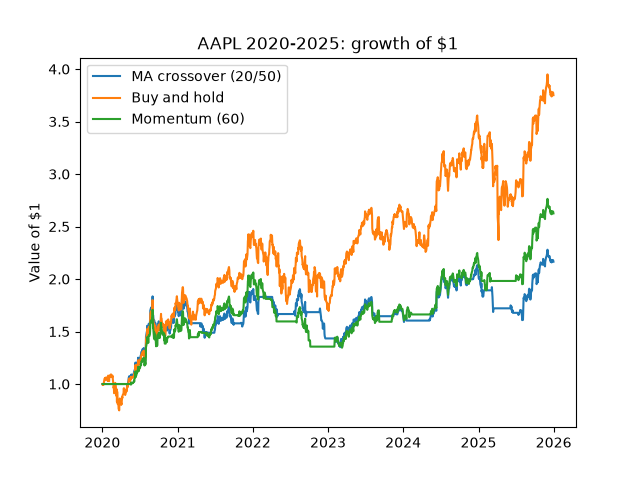

# Paper Trading Bot


This is a learning project.


This code is a Python backtester for simple trading strategies on US stocks. It downloads daily prices, turns them into buy/sell signals, simulates the strategy, and compares it against just buying and holding.

The long-term goal is to run the same strategies live on an Alpaca paper trading account.

## Results

Both strategies were tested on **AAPL**, *January 2020* to *December 2025* (1,508 trading days):



| Metric | MA crossover | Momentum (60) | Buy and hold |
|---|---|---|---|
| Total return | +116.5% | +163% | +275.1% |
| Max drawdown | -29.1% | -35% | -33.4% |
| Sharpe ratio | 0.74 | 0.87 | 0.85 |

## What I found

The strategy makes money, but less than half of what buy and hold made. AAPL went up a lot over this period, and the strategy spent a big part of it in cash. Moving averages only cross after a trend has already started, so it buys late and sells late.

It did have a smaller worst drop (-29% vs -33%). The Sharpe ratio is lower, so it didn't make up for the lost return by taking less risk.

The momentum **made** more than the MA crossover and less than buy-and-hold. **Buy-and-hold made the most money by a lot**. Momentum's Sharpe ratio is slightly higher than buy-and-hold (0.87 vs 0.85), but that gap is too small to mean much on one stock. It also had the worst drop of the three (-35%), so it didn't get out early enough to avoid the crashes.

Neither strategy beat just holding AAPL over this period.

## How it works

- `data.py` downloads daily closing prices with yfinance and caches them as CSV files in `data/`
- `strategy.py` has two strategies. Each returns 1 (hold the stock) or 0 (stay in cash) for every day:
  - MA crossover: holds when the 20-day average is above the 50-day average
  - Momentum: holds when today's price is higher than it was 60 days ago
- `backtest.py` uses the previous day's signal for each day's return, so the strategy can't see the future
- `metrics.py` calculates total return, max drawdown and annualized Sharpe ratio

## Running it

Needs **Python 3.10** or newer.

```
python -m venv .venv
.venv\Scripts\activate        # Windows
source .venv/bin/activate     # Mac/Linux
pip install -e ".[dev]"
```

Run the backtest (prints the metrics and saves `backtest.png`):

```
python run_backtest.py
```

Run the tests:

```
pytest
```

## Next steps to finish the project

- Transaction costs
- Testing on other tickers (SPY, MSFT, TSLA)
- More strategies (RSI)
- Live paper trading with the Alpaca API
